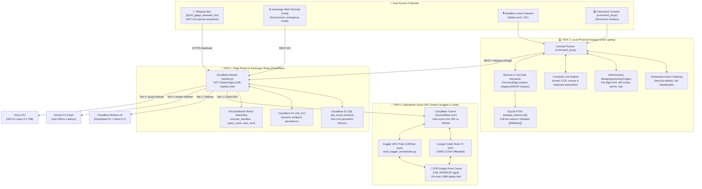
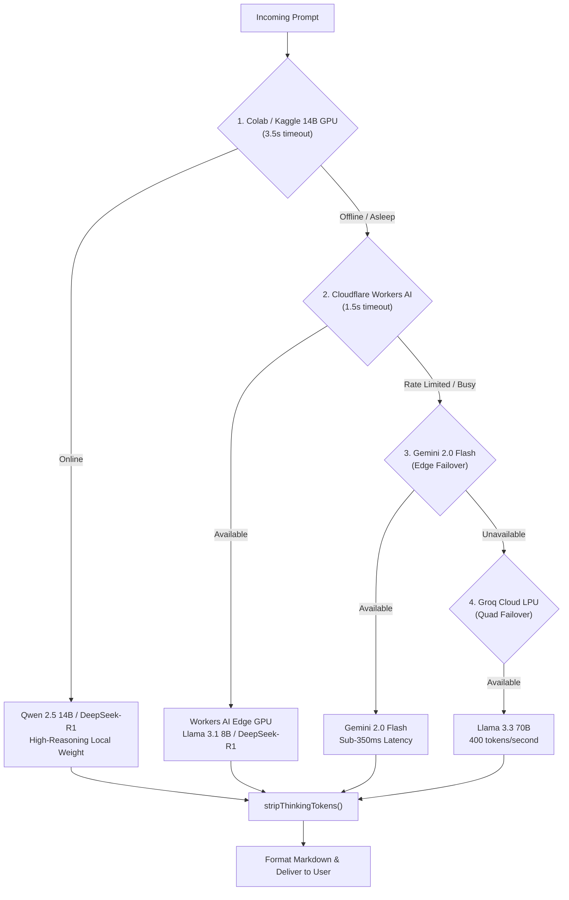
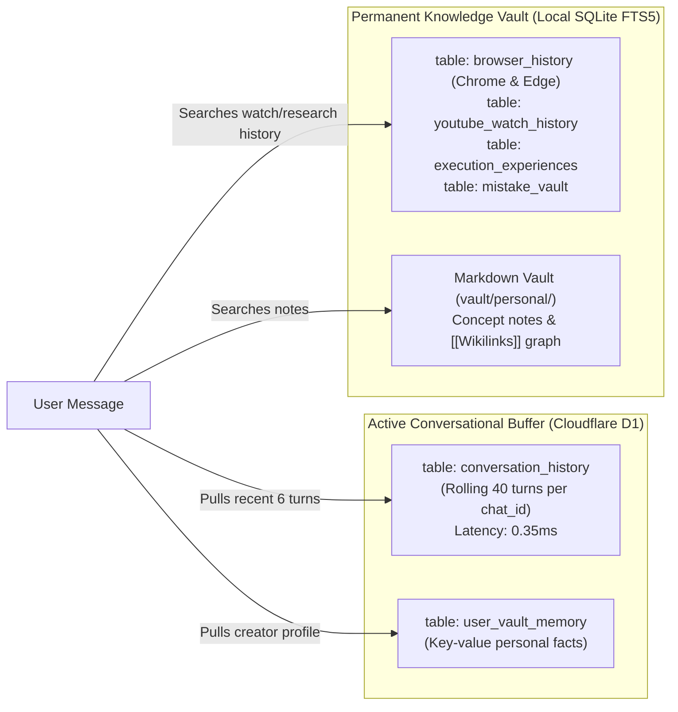

# JAI System Architecture & Technical Master Guide
**Unified Sovereign Cloud-Edge AI Ecosystem**

---

## 📑 Table of Contents
1. [Executive Summary & Architectural Vision](#1-executive-summary--architectural-vision)
2. [The Non-Negotiable Core Invariants](#2-the-non-negotiable-core-invariants)
3. [System Topology & High-Level Architecture](#3-system-topology--high-level-architecture)
4. [Tier 1: Global Edge Router & Sovereign Relay (Cloudflare)](#4-tier-1-global-edge-router--sovereign-relay-cloudflare)
5. [Tier 2: Distributed Cloud Compute Swarm (Kaggle & Colab)](#5-tier-2-distributed-cloud-compute-swarm-kaggle--colab)
6. [Tier 3: Local Physical Actuator & Knowledge Vault (Laptop)](#6-tier-3-local-physical-actuator--knowledge-vault-laptop)
7. [Cognitive Engine & Multi-Tier Model Council](#7-cognitive-engine--multi-tier-model-council)
8. [The Autonomous Self-Evolving Engine (Safe Metaprogramming)](#8-the-autonomous-self-evolving-engine-safe-metaprogramming)
9. [Action Gateway & Declarative Security Architecture](#9-action-gateway--declarative-security-architecture)
10. [Memory Architecture & Dual-Store Knowledge Vault](#10-memory-architecture--dual-store-knowledge-vault)
11. [Master Operational Guide (Everyday Workflows)](#11-master-operational-guide-everyday-workflows)
12. [Disaster Recovery & Sovereign Data Export](#12-disaster-recovery--sovereign-data-export)

---

## 1. Executive Summary & Architectural Vision

**JAI (Just Autonomous Intelligence)** is a sovereign, self-evolving, personal AI assistant designed to eliminate the trade-off between **complete local privacy** and **cloud-scale compute power**.

Unlike proprietary consumer AI platforms (ChatGPT, Claude, Copilot) that lock users into closed subscriptions and cloud walled gardens, JAI operates as a **tri-hybrid, zero-cost architecture**:
1. **Always-On Edge (300+ Cities):** Operates 24/7 on Cloudflare Workers and Cloudflare D1 SQL database at $0.00 cost, accepting inputs via Telegram and an emergency web interface even when the user's laptop is powered off.
2. **Ephemeral Cloud Compute Swarm:** Dynamically provisions up to 120 hours/week of dedicated 16GB Tesla T4 GPU compute across rotated Kaggle and Google Colab sessions, keeping heavy 14B/32B open-weight models completely off local laptop SSDs.
3. **Local Screen & App Actuator:** Runs a lightweight client on the user's laptop (~15 MB memory footprint) that controls physical displays, moves cursors, fills assignments, harvests browsing history, and speaks via voice without bogging down potato hardware.

---

## 2. The Non-Negotiable Core Invariants

Every subsystem in JAI must strictly adhere to the following six engineering rules:

| Rule | Invariant | Enforcement Mechanism |
| :--- | :--- | :--- |
| **1. Budget Hard Limit** | **$0.00 / month forever** | Only free tiers (Cloudflare Free, Telegram Bot API, Kaggle 30h/wk, Colab T4, Gemini Free Tier, Groq Free Tier). Zero paid APIs. |
| **2. Zero Local Disk Wear** | **<3.5 GB local storage** | 9GB+ GGUF model files are stored in 5TB Google Drive / Hugging Face and loaded into cloud GPU VRAM. Zero heavy weights on laptop SSD. |
| **3. Hardware Reality Math** | **$\le$ 8 GB RAM local footprint** | Keep local models strictly $\le$ 3B if offline. All heavy 14B–70B reasoning is routed to cloud GPUs or fast edge failovers. |
| **4. Human-in-the-Loop** | **No autonomous irreversible action** | `ActionGateway` intercepts form submits, financial transactions, file deletions, and self-modifications with mandatory `[y/N]` approval gates. |
| **5. Anti-Brick Self-Evolution** | **AST & Compilation verification pre-flight** | JAI cannot overwrite its own code without passing syntax checks, automated test suites, and creating rolling `.bak` snapshots. |
| **6. Ground Truth Memory** | **Dual-store persistence** | Real-time chat history in Cloudflare D1 (Cloud SQL); deep personal notes and browsing history in SQLite FTS5 (`data/jai_memory.db`). |

---

## 3. System Topology & High-Level Architecture

The JAI ecosystem is partitioned into three decoupled tiers connected by secure, authenticated communication channels:



---

## 4. Tier 1: Global Edge Router & Sovereign Relay (Cloudflare)

The edge layer is permanently deployed at `https://jai-brain.jagath1105.workers.dev` on Cloudflare’s global network across 300+ edge locations. It acts as the 24/7 central nervous system.

### Key Capabilities:
1. **Telegram Webhook Ingestion:** Ingests messages from `@JAI_gjaga_assistant_bot` in under 35ms.
2. **Strict Identity Gate:** Cryptographically enforces user ID authentication (`chat_id == 8999741671`), dropping unauthorized access instantly.
3. **Cloudflare D1 Persistence:**
   * Reads the last 6 turns of multi-turn conversation history in 0.35ms.
   * Stores long-term user profile facts in `user_vault_memory`.
   * Automatically enforces rolling 40-message buffers to prevent bloat.
4. **Token Sanitization Engine:**
   * Houses `stripThinkingTokens()` to cleanse `<think>...</think>` tokens emitted by DeepSeek-R1 and reasoning models before messages reach Telegram or D1 history.
5. **V8 Sandboxed ReAct Watchdog:**
   * Executes computational code and algorithms in an isolated edge sandbox (`execute_sandbox`) to verify math and algorithmic answers before returning responses.
6. **Sovereign Emergency Web Terminal:**
   * Serves a standalone dark-mode terminal UI at `/chat` allowing complete access from any phone or browser if Telegram is unreachable.

---

## 5. Tier 2: Distributed Cloud Compute Swarm (Kaggle & Colab)

To satisfy the **$0 budget** and **0 MB local model weight** constraints, all heavy neural computation runs on free Google Colab and Kaggle Tesla T4 GPUs (15,360 MB VRAM).

```mermaid
flowchart LR
    Orch["Multi-Kaggle Orchestrator<br/>(src/multi_kaggle_orchestrator.py)"]
    
    subgraph Accounts["4-Account Kaggle Pool (120h / week)"]
        A1["Account 1: 30h"]
        A2["Account 2: 30h"]
        A3["Account 3: 30h"]
        A4["Account 4: 30h"]
    end
    
    Orch -->|Selects Account with Max Budget| Accounts
    Accounts -->|Pushes Kernel via API| KaggleKernel["Qwen 2.5 14B / DeepSeek-R1 Server<br/>(kaggle/qwen2.5_14b_server.ipynb)"]
    KaggleKernel -->|Mounts 5TB Google Drive| GDrive["/content/drive/MyDrive/JAI_MODELS/<br/>(Instant 15s Boot)"]
    KaggleKernel -->|Spins up llama.cpp server| LlamaServer["llama-server (Port 8080)<br/>OpenAI-compatible /v1"]
    LlamaServer -->|Exposed via Cloudflare Tunnel| CFTunnel["https://xxxx.trycloudflare.com/v1"]
    CFTunnel -->|Auto-Sync via Telegram/Webhook| CFWorker["Tier 1 Edge Worker"]
```



### Mathematical Memory Proof (Tesla T4 GPU):
$$\text{Available VRAM} = 15,360 \text{ MB}$$
$$\text{Qwen 2.5 14B Instruct Q4\_K\_M} \approx 9,200 \text{ MB}$$
$$\text{Context KV Cache (4096 tokens, FP16)} \approx 1,400 \text{ MB}$$
$$\text{CUDA Runtime Overhead} \approx 650 \text{ MB}$$
$$\text{Total VRAM Consumed} = 11,250 \text{ MB} \le 15,360 \text{ MB}$$
$$\text{Safety Headroom} = 4,110 \text{ MB (Zero OOM Risk)}$$

---

## 6. Tier 3: Local Physical Actuator & Knowledge Vault (Laptop)

The local tier executes on the user's laptop using lightweight Python scripts. It is the only component that touches the physical screen, keyboard, and local files.

### Core Modules:
1. **Interactive Runner ([`command_jai.py`](file:///c:/Users/gjaga/jai/command_jai.py)):**
   * Central command dispatcher for terminal queries, web search, form-filling, code self-repair, and hardware monitoring.
2. **Computer Use Engine ([`src/computer_use_engine.py`](file:///c:/Users/gjaga/jai/src/computer_use_engine.py)):**
   * Captures screen pixels via Win32 GDI, passes images to Gemini Vision for grounding, and simulates human-like mouse movements and keystrokes to solve assignments and navigate websites.
3. **Browser History Harvester ([`src/browser_history_harvester.py`](file:///c:/Users/gjaga/jai/src/browser_history_harvester.py)):**
   * Uses non-blocking shadow staging to copy Chrome and Edge SQLite databases without triggering Windows `EBUSY` locks.
   * Parses WebKit microsecond timestamps and indexes YouTube watch histories into local FTS5 SQLite.
4. **Obsidian Vault Graph Linker ([`src/vault_graph_linker.py`](file:///c:/Users/gjaga/jai/src/vault_graph_linker.py)):**
   * Scans markdown notes in `vault/` and automatically connects concepts using bi-directional `[[Wikilinks]]`.
5. **Headless Voice Daemon ([`src/voice_listener.py`](file:///c:/Users/gjaga/jai/src/voice_listener.py)):**
   * Real-time wake-word listener ("JAI") running headless in the background with zero GUI, audio chimes, and Windows SAPI5 TTS.

---

## 7. Cognitive Engine & Multi-Tier Model Council

JAI uses a Quad-Cloud failover cascade so the user never experiences downtime or rate limits:



---

## 8. The Autonomous Self-Evolving Engine (Safe Metaprogramming)

To satisfy the user requirement: *"How to make JAI change its own code on my command"*, JAI implements an automated, self-healing metaprogramming pipeline in [`src/self_evolving_engine.py`](file:///c:/Users/gjaga/jai/src/self_evolving_engine.py):

### The 6-Stage Self-Evolution Lifecycle:
1. **Target File Resolution:** Resolves target files inside the repo while strictly blocking changes to `.git`, `.venv`, `.env`, and database files.
2. **Negative Constraint Memory Injection:** Queries `MistakeVault` from [`src/self_learning.py`](file:///c:/Users/gjaga/jai/src/self_learning.py) to inject historical failure memories into the prompt so past bugs are never repeated.
3. **Pre-Flight AST & Bytecode Gate:** Runs `ast.parse()` and `py_compile` in a temporary virtual sandbox. If a syntax or indentation error is detected, the patch is rejected immediately with zero disk alterations.
4. **Visual Color Diff Review:** Displays a unified line-by-line diff (`+` additions, `-` deletions) directly in the console.
5. **Human-in-the-Loop Confirmation:** Prompts the user: `Apply this modification to <file>? [y/N]`.
6. **Atomic Replacement & Rolling Snapshot:** Copies `file.py` to `file.py.bak` and timestamped `file.py.bak_YYYYMMDD_HHMMSS`, then atomically replaces the target file via `os.replace`.
7. **Instant Rollback:** If any issue arises, running `rollback <file>` restores the previous version in 0 milliseconds.

---

## 9. Action Gateway & Declarative Security Architecture

To guarantee safety during autonomous computer use and code modification, JAI implements a declarative security policy engine in [`src/action_gateway.py`](file:///c:/Users/gjaga/jai/src/action_gateway.py):

| Risk Level | Operations | Gateway Decision | Behavior |
| :--- | :--- | :--- | :--- |
| **LOW** | Screen perception, OCR, web reading, note viewing | `ALLOW` | Transparent automated passthrough |
| **MEDIUM** | Navigation clicks, temporary drafts, local testing | `ALLOW` | Auto-logged with audit trail |
| **HIGH** | Exam submissions, form posts, file self-modifications | `REQUIRE_APPROVAL` | Halts execution until explicit `[y/N]` human confirmation |
| **FATAL** | `format C:`, token exfiltration, terminal forkbombs | `DENY` | Hard blocked; raises `ActionSecurityError` |

All decisions are permanently recorded in `data/action_gateway_audit.jsonl` for compliance and auditability.

---

## 10. Memory Architecture & Dual-Store Knowledge Vault

JAI avoids fragmented memory by separating active conversation turns from permanent semantic knowledge:



---

## 11. Master Operational Guide (Everyday Workflows)

### A. Daily Operations from Your Phone (Telegram)
* Open Telegram and chat with `@JAI_gjaga_assistant_bot`.
* **Health & Status:** Send `/status` to view live edge failover state, active GPU endpoints, and host clock.
* **Live Search:** Send `/search <query>` to retrieve real-time Google News and web search results.
* **Financial Council:** Send `/stock NVDA` to trigger the 8-Chamber Brutal Investment Council audit.
* **Paper Trading:** Send `/portfolio` to inspect your 30-day virtual trading ledger.
* **Memory Reset:** Send `/clear` to wipe active chat history in D1 for a fresh thread.

### B. Daily Operations from Your Laptop Console
Open PowerShell in `c:\Users\gjaga\jai` and run:
```powershell
python command_jai.py
```
* **Ask Any Question:** Just type your prompt (`Explain quantum computing in 2 sentences`).
* **Web Search:** `search latest breakthroughs in humanoid robotics`.
* **Harvest Browser History:** `history` (indexes Chrome, Edge, and YouTube history from the past 24 hours).
* **Watch Recall:** `recall Elon Musk` (instantly finds videos or reels you watched).
* **Self-Evolve Code:** `evolve command_jai.py Add /battery status command`.
* **Restore Code:** `rollback command_jai.py`.
* **Live Hardware Audit:** `redflag` (probes RAM, VRAM, and checks budget limits).

### C. Booting the Cloud GPU Swarm (Kaggle)
From the JAI console:
```text
> kaggle status   # Inspect weekly hours remaining across accounts
> kaggle boot     # Autonomously pushes notebook & launches Qwen 14B on Tesla T4 GPU
> kaggle stop     # Stops session and records elapsed hours
```

---

## 12. Disaster Recovery & Sovereign Data Export

JAI guarantees 100% data sovereignty. You are never locked into any platform:

### 1. Exporting Cloud Memory from Edge D1:
Navigate to:
```text
https://jai-brain.jagath1105.workers.dev/export_vault?auth=8999741671
```
Or execute the automated local backup script:
```powershell
python src/backup_jai_cloud.py
```
This downloads a full JSON snapshot of all Cloudflare D1 tables to `vault/cloud_backups/jai_vault_latest.json`.

### 2. Atomic Google Drive Backup:
From the JAI console, type:
```text
> backup
```
This performs a non-blocking snapshot of `data/jai_memory.db` and syncs your personal knowledge vault directly to your 5TB Google Drive.

### 3. Deploying to Any New Laptop in 60 Seconds:
On any new desktop or potato laptop:
```bash
git clone https://github.com/jagath0511-ui/jai.git
cd jai
pip install -r requirements.txt
python command_jai.py
```
JAI immediately links back to your 24/7 Cloudflare edge router and Google Drive model cache.
